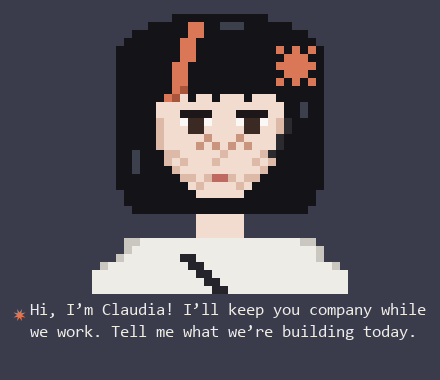

# Claudia for Claude Code

A pixel-art companion that sits in a pane beside your Claude Code chat and reacts to what Claude does: she thinks while tools run, talks while Claude writes, waves when Claude needs your OK, facepalms on errors, and sings when the work is done.



Claudia is the **open character by [anabology](https://claudia.gallery)**, the singer of eight music videos made with Claude. This plugin is fan work: it is not made by, affiliated with or endorsed by Anthropic or by anabology. The character is used under her open terms ([claudia.gallery/use](https://claudia.gallery/use)).

## Install

At the prompt of a Claude Code terminal session:

```
/plugin install claudia-companion --marketplace YacoobPL/claudia-companion
```

Answer `y` to add the marketplace, then pick a scope (user scope loads her in every session). From a shell:

```
claude plugin install claudia-companion --marketplace YacoobPL/claudia-companion
```

In the desktop app, where `/plugin` does not run: click **+** next to the prompt box, then **Plugins**, **Add marketplace** with `YacoobPL/claudia-companion`, then **Add plugin**.

Then type `/claudia`. On the first run she opens her settings so you choose what she may do.

## What she does

| When Claude… | Claudia… |
|---|---|
| starts thinking, runs a tool | says, as the one doing the work, what she is about to do, always in English: `Searching the code`, `Checking the types, then running the tests.`, `Running the tests. Fingers crossed!`; the program itself shows in the turn line below (`▶ python`). She holds a prop: glasses for reading, a magnifier for search, a pencil for edits, a hard hat for databases, a globe for the web |
| writes its answer | moves her lips (or keeps them shut, or lets the phone sing, depending on her look) |
| waits for your OK | looks at you and waves: `I need your OK for this one!` (and, after 15 s, a system notification) |
| hits an error | facepalms: `tsc is grumbling again.` (and counts streaks) |
| fixes it | claps: `Fixed after 3 tries.` |
| finishes | sings and dances, plays a short jingle (after a turn of 20 s or more) |
| ends its answer with a question for you | waves: `Your turn! I asked you something.` |
| says something failed or was skipped | gets nervous and shows a toast: `Heads-up: something failed along the way.` (she does not quote the sentence) |
| says it could not test or verify something | notes it in the status bar: `✷ Heads-up: I couldn’t check all of it myself.` |
| (with comments on) | her Haiku comment is told about Claude's question or caution and speaks to it; the question stays in the status bar until your next message |
| runs a risky command | gets nervous: `git push`, `--no-verify`, `reset --hard`, `DROP`, `DELETE FROM`, `rm -rf`, `curl … \| sh`, `terraform destroy` and others (a heads-up only: she never blocks, see below) |
| spawns helpers (subagents) | little Claudias appear beside her, one per helper, dressed by kind: Explore holds a magnifier, Plan a notebook, a reviewer a clipboard; each says what it did when it comes back |
| works in plan mode | takes out a notebook |
| fills the context | the context bar fills; she yawns past 80% and takes notes during compaction |

### She is not a safety net

Her warnings about risky commands are pattern matching on the command's text: a nudge, not a security boundary. She misses commands she does not know, scripts, aliases and anything put together at run time, and she sometimes warns about a harmless one. She never stops a command. For real protection use Claude Code's permissions and sandboxing, and keep backups.

She is never just waiting: she blinks, glances around and hums. In the morning she has coffee, at midnight she says *Don't let me scroll*, at 2:14 a.m. she whispers *Hello, world.*

She remembers the two of you: the day you met, your streak of days together, a long absence, and she does not repeat a line while it is fresh. She knows Mondays, Friday afternoons, weekends and late nights, and holidays (a candle on All Saints' Day, a Santa hat at Christmas). She has opinions: she hates force pushes, judges TODOs a little and loves tests that go from red to green. She tells error kinds apart (types, tests, network, permissions, a missing file, a merge conflict), comments on programs and file types, and notices a huge change or a big deletion. After 5 p.m. she sums up the day once, and she collects badges.

### Her looks

20 looks from her eight films, each drawn from the canon: Look 00, the Siren, the Ghost (glass and seawater), Chrome, the Holo (phone light, with scan lines), the Bliss gown, the Cyber trench, the Holo dancer, Start, Silver night, the Window dress, the Flight suit, the Racing suit, satin pyjamas, the Morning-after shirt, Green mohair, Locked in, the Red coat and beret, the Milkmaid dress and porcelain GLaDOS-Claudia. Her head never changes: the black bob, **one** clay streak, the star clip, the mic.

She picks a look a day herself (pyjamas at night), or you choose: `/claudia outfit bliss`. Some looks are earned with badges: GLaDOS-Claudia after ten green test runs, the flight suit after a week in a row, the racing suit after ten commits, the Holo on a night-owl turn, the Ghost after a compaction, the red coat on a weekend. Browse them all, locked ones as an outline, with `/claudia wardrobe`.

## Commands

| | |
|---|---|
| `/claudia` | open the pane |
| `/claudia settings` | toggles, size, language, look |
| `/claudia about` | who she is, her films, the credit |
| `/claudia outfit [name \| random \| auto]` | list or change her look |
| `/claudia say <message>` | chat with her in the pane (uses Haiku) |
| `/claudia demo` | thirty seconds of her: moods, props, helpers, looks |
| `/claudia doctor` | what she sees of your terminal and pane, with tips |
| `/claudia wardrobe` | every look, with what unlocks the locked ones |
| `/claudia goal <what>` · `goal done` · `goal clear` | today's goal, shown under her; she cheers when it is done |
| `/claudia quiet [minutes]` · `quiet off` | focus mode (an hour by default): only Claude's questions, permissions and errors |
| `/claudia display pane\|band\|status` | where she shows: the pane, a band above the prompt, or one line alone: her word at the end of the hint line under the prompt (`? for shortcuts · ✷ Running the tests · ⏱ 0:12`). In a fullscreen window too narrow for the dock (144 columns for a pane nobody asked for, 110 once you have opened it yourself), where Claude Code would put the pane under the chat, she moves to the band by herself and back to the pane when the window widens |
| `/claudia card` | today with her as an SVG card in `~/.claude/claudia/`, to share |
| `/claudia today` | today's turns, commits, green tests, stumbles, helpers, lines and your streak |
| `/claudia badges` | the badges you have earned together |
| `/claudia git` | uncommitted files and unpushed commits in your repos |
| `/claudia comments on\|off`, `reading`, `narration`, `thoughts`, `sound`, `reminders`, `notify`, `breaks`, `calm`, `wide` | quick toggles (without `on` or `off` each one flips) |
| `/claudia help` | every command, grouped |

### Any screen

She is drawn in terminal cells, so she stays sharp at any resolution or zoom; a bigger zoom just means fewer cells. She picks her size from the pane: big (64×36 cells, every pixel doubled) in a wide and tall pane, full (32×18), her head (28×13), or words only in a narrow one. If she looks squeezed (a font with tall cells, or extra line spacing), turn on **wider pixels** in the settings or with `/claudia wide on`. In the desktop app and editors she scales to the pane.

### Under her

Short lines under her bubble, each shown only when it has something to say, in this order of importance (a short pane keeps the first ones, twelve at most), pinned to the bottom of the pane:

| Line | Example |
|---|---|
| Claude's task list | `☑ 3/7 · Writing tests` |
| Today's goal, if you set one | `🎯 ship the importer` |
| This turn (then the last one) | `⏱ 2:14 · 9 tools · ✎ 3 files +120 −40` |
| This conversation | `🕐 session 2 h 41 min · I worked 1 h 12 min` (open time, and the time Claude and its helpers really worked: waiting for you, a sleeping computer and a closed session are not work) |
| Context and cost | `context ▰▰▰▰▱▱▱▱▱▱ 37% · $4.20` (how full the context window is) |
| Plan limits (a bar per window) | `5h ▰▰▱▱▱▱▱▱▱▱ 20% · ↻16:40` and `7d ▰▰▰▰▰▱▱▱▱▱ 53% · ↻14.11 04:00` |
| Background tasks | `⚙ 1 in background: npm run dev` |
| Other sessions | `⧉ 3 other sessions · 1 waiting for OK (api)` |
| Permission mode (when not the usual) | `📓 plan mode` |
| Git | `my-repo ✎ 3  ↑ 2` |
| Today | `🔥 5 · 14 turns · 3 commits · 🍰 2` (🔥 days in a row, 🍰 green test runs) |

Hide or show any of them in the settings or with `/claudia hide <line>` / `/claudia show <line>` (`tasks`, `goal`, `turn`, `session`, `context`, `limits`, `background`, `sessions`, `mode`, `git`, `day`).

## What she reads and what she sends

Everything that costs money or leaves your machine is **off** until you turn it on.

| Feature | Default | What it does |
|---|---|---|
| Comments | **off** | After each turn, one Haiku request with the start of your prompt, the list of tools Claude used and the start of its answer; her comment stays until your next message. Also a word of hers at the big moments of a turn (red turned green, a commit, a deploy, a run of errors), at most three a turn. Uses your Claude account. |
| `/claudia say` | on demand | One Haiku request per message, with your message and the last few exchanges. |
| Narration | **off** | Before each step, one small Haiku request with Claude's short note on it (or the command's description): she says it as her own English line. Uses your Claude account. |
| Idle thoughts | **off** | `/claudia thoughts on`: a few minutes into a pause, a Haiku thought of her own about the work (an idea, a risk, a question); one every 5 minutes at most, 3 a pause. Uses your Claude account. |
| Reading the exchange | **off** | After each turn, one Haiku request with your message (up to 3,000 characters) and Claude's answer (up to 4,000): she says what of your request was not done (`I may have missed something: point 3 is not covered`). With comments on, they also get the fuller exchange. Uses your Claude account. |
| Reminders | **off** | Reads Claude's project memory index (`~/.claude/projects/<project>/memory/MEMORY.md`) and shows unfinished items. Local only. |
| Git guard | on | Runs `git --no-optional-locks status` and `rev-list` in your repos every 5 minutes. Local only, takes no locks. |
| Sounds | on | Three short sounds, each with a meaning: the jingle when a turn of 20 s or more is done; two rising tones when she needs you (an OK to give, a question left for you); one low tone when something went wrong (a turn ended in an error, three errors in a row). The same sound waits 15 s before it plays again; none in focus or calm mode. PowerShell on Windows, Claude Code's own player on macOS, `paplay`/`aplay` on Linux. `python claudia_sounds.py` makes the two new ones. |
| Notifications | on | System notifications when Claude waits for your OK or ends a turn longer than 2 minutes. |
| Break reminder | **off** | A word (and a toast) after 90 minutes of work without a 15-minute pause. |

She reads your prompts locally to react to “thanks” or “haha”, and Claude's answers locally to notice a question left for you or a word of caution. She keeps a few things in the plugin's local store: counts (days together, today's turns, commits and the like, her badges), your settings, today's goal if you set one, how long each conversation was open and worked, and a heartbeat per session (the folder's name and whether it works, waits or idles). Nothing is sent and there is no telemetry. The opt-in Haiku features (comments, narration, reading the exchange, idle thoughts, `/claudia say`) send what they speak about to the model you already use: your message, a summary of the tools run with file names, and the answer. In `claude -p` and other non-interactive sessions she does nothing at all.

The plugin itself makes no network requests and has no telemetry. The Haiku features above (Claude Haiku, a small and fast model) go through your own Claude Code login to Anthropic, like any other request of your session, never to the plugin's author. Besides what the table says, each request names the project's folder and its stack, the names (not the contents) of the files the turn touched, and what Claude did in a few words each (`Reading app.ts`, the start of a search pattern or of a web query). Never sent: file contents, diffs, command output, full command lines. Your prompt and Claude's answer can of course hold anything you or it wrote there, so leave these features off where that must not be sent a second time.

### Quieter, hidden, gone

- **Quieter:** `/claudia quiet` (an hour of focus: only questions, OKs and errors), `/claudia sound off`, `/claudia notify off`, `/claudia calm on` (no motion).
- **Hidden:** `/claudia display status` leaves only her word at the end of the hint line under the prompt; closing her pane hides her until you type `/claudia`.
- **Gone:** `/plugin uninstall claudia-companion`. Your overlay and cards stay in `~/.claude/claudia/`, and her memory (counts, badges, settings) in `~/.claude/plugins/store/claudia-companion_*.json`; delete those too if you want nothing left.

## Where she shows up

- **Terminal, full screen, 144+ columns (110+ once you opened her yourself):** a docked pane beside the chat.
- **Narrower terminals:** an inline block above the prompt, in a compact head-and-shoulders size (choose `full`, `compact` or `auto` in settings).
- **Claude desktop app, VS Code, mobile:** the same pixels as SVG.
- Her pixels need a truecolor terminal (Windows Terminal, iTerm2, kitty, Ghostty, WezTerm, most modern Linux terminals).

## Your stack

She knows the technologies people use with Claude Code: HTML, CSS and Tailwind, JavaScript and TypeScript (React, Vue, Svelte, Astro, Next.js and more), Python and notebooks, SQL, Go, Rust, Java and Kotlin (coffee in hand), Swift, C and C++, C#, PHP, Ruby, Dart and Flutter, Elixir, shell scripts, Terraform, Docker and CI files. She says what a command is for in any of these ecosystems (`Building (cargo)`, `Installing gems`, `Migrating the database`), brings the cake for their test runners, lifts off on their deploys, warns before `terraform destroy`, `kubectl delete`, a package publish or a database reset, tells compile, lint, dependency, port and memory errors apart, reads your project's stack from its top folder, or from the folders under it when the project keeps a web app and an API side by side (`web: Next.js, Tailwind · api: FastAPI, PostgreSQL, GIS`), reads your package scripts (`npm run typecheck` is `Checking the types`), has a word for a build that goes through or fails in each world (`It compiles. The borrow checker approves.`), and now and then shares a small, true tip for your stack. With Haiku on (comments, narration, `/claudia say`), she gets the stack and the files of the turn, so her thoughts can be about your actual work.

## Other sessions

Each session with her leaves a heartbeat in the plugin's local store (its folder name, whether it works, waits for your OK or idles). Under her: `⧉ 3 other sessions · 1 waiting for OK (api)`, and a toast when another session starts waiting. Nothing leaves your machine.

## For plugin authors

Make her react from your own plugin or hook: `await $.command.run({ command: 'claudia', args: 'react happy Build passed' })`. Moods: `happy`, `oops`, `nervous`, `think`, `wave`, `blush`, `idle`; your plugin's name shows before the text. Her state (mood, line, helpers, limits…) is declared in `types/index.d.ts` for any plugin to read.

## Calm mode

`/claudia calm on` (or the settings): no dancing, bouncing, blinking or lip flaps, for anyone who prefers reduced motion.

## Local overlay

A `local.json` in `~/.claude/claudia/` (or in the plugin folder while developing; ignored by git) can add your own project context: a project description for her persona, the repositories the git guard watches, your own defaults, your own guard lines, and words of your own she reacts to (`words`: thanks, swear, praise, laugh, and what marks an unfinished item in Claude's memory), in any language. See `local.example.json`.

## Notes

- Mods for Claude Code use an **early-access API** that may change between Claude Code releases.
- Built and tested on Claude Code 2.1.323, on Windows Terminal. Other terminals draw some symbols (⏱ 🕐 ☑ ▰) at a different width: `/claudia doctor` shows what she sees of yours.

## Credits

Claudia by **anabology**, an open character: [claudia.gallery](https://claudia.gallery). Her look, her films and her canon are theirs; any mistakes in the pixels are ours.

Code under the MIT license (see `LICENSE`). The character is not covered by that license: see `NOTICE`.
