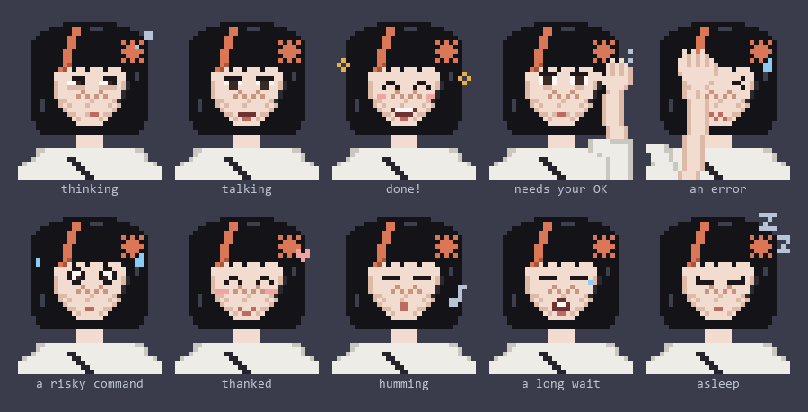
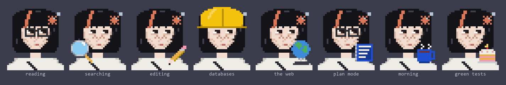
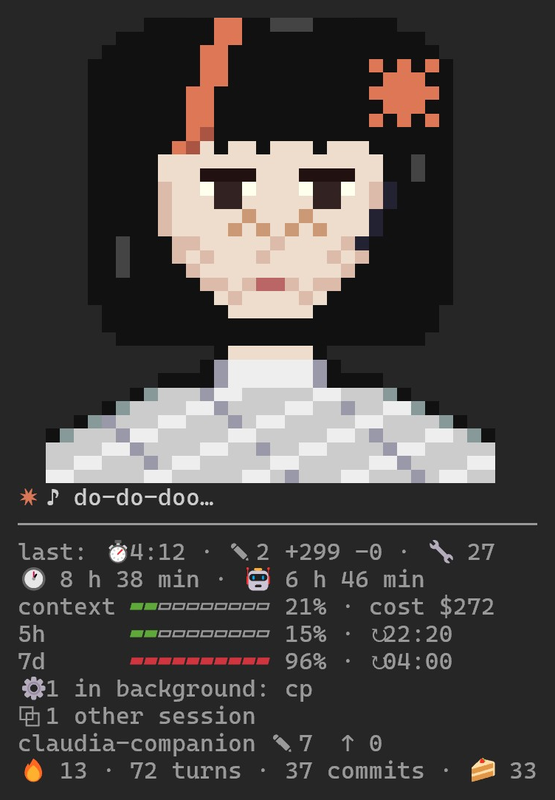
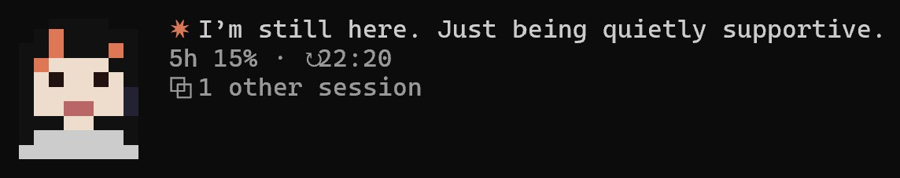

# Claudia for Claude Code

A pixel-art companion who sits beside your Claude Code chat and reacts to the work: she thinks while tools run, talks while Claude writes, waves when Claude needs your OK, facepalms on errors, and sings when the work is done.


Claudia is the **open character by [anabology](https://claudia.gallery)**, the singer of eight music videos made with Claude. This plugin is fan work: it is not made by, affiliated with or endorsed by Anthropic or by anabology. The character is used under her open terms ([claudia.gallery/use](https://claudia.gallery/use)).

- [Install](#install)
- [What she does](#what-she-does)
- [Where she shows](#where-she-shows)
- [Commands](#commands)
- [The lines under her](#the-lines-under-her)
- [What she reads, sends and costs](#what-she-reads-sends-and-costs)
- [Quieter, hidden, gone](#quieter-hidden-gone)
- [Her looks and her memory](#her-looks-and-her-memory)
- [Your stack](#your-stack)
- [Extending her](#extending-her)
- [Problems and ideas](#problems-and-ideas)

## Install

At the prompt of a Claude Code terminal session:

```
/plugin install claudia-companion --marketplace YacoobPL/claudia-companion
```

Answer `y` to add the marketplace, then pick a scope (user scope loads her in every session). The same from a shell:

```
claude plugin install claudia-companion --marketplace YacoobPL/claudia-companion
```

In the desktop app, where `/plugin` does not run: click **+** next to the prompt box, then **Plugins**, **Add marketplace** with `YacoobPL/claudia-companion`, then **Add plugin**.

Then type `/claudia`. On the first run she opens her settings, so you choose what she may do before she does it.

To update her later, from a shell (then start a new session):

```
claude plugin marketplace update claudia-companion
claude plugin update claudia-companion@claudia-companion
```

## What she does



| When Claude… | Claudia… |
|---|---|
| starts thinking, runs a tool | says what she is about to do, as the one doing the work, always in English: `Searching the code`, `Checking the types, then running the tests.`, `Running the tests. Fingers crossed!`. She holds a prop: glasses for reading, a magnifier for search, a pencil for edits, a hard hat for databases, a globe for the web |
| writes its answer | moves her lips (or keeps them shut, or lets the phone sing, depending on her look) |
| waits for your OK | looks at you and waves: `I need your OK for this one!`, and after 15 s sends a system notification |
| hits an error | facepalms: `tsc is grumbling again.`, and counts streaks |
| fixes it | claps: `Fixed after 3 tries.` |
| finishes | sings and dances, and plays a short jingle after a turn of 20 s or more |
| ends its answer with a question for you | waves: `Your turn! I asked you something.` |
| says something failed or was skipped | gets nervous and shows a toast: `Heads-up: something failed along the way.` |
| says it could not test or verify something | notes it in the status bar: `✷ Heads-up: I couldn’t check all of it myself.` |
| runs a risky command | gets nervous: `git push`, `--no-verify`, `reset --hard`, `DROP`, a `DELETE FROM` with no `WHERE`, `rm -rf`, `curl … \| sh`, `terraform destroy` and others |
| spawns helpers (subagents) | little Claudias appear beside her, one per helper, dressed by kind: Explore holds a magnifier, Plan a notebook, a reviewer a clipboard. Each says what it did when it comes back |
| works in plan mode | takes out a notebook |
| fills the context | the context bar fills; she yawns past 80% and takes notes during compaction |



She is never just waiting: she blinks, glances around and hums, and after ten quiet minutes she falls asleep. In the morning she has coffee, at midnight she says *Don't let me scroll*, at 2:14 a.m. she whispers *Hello, world.*

### She is not a safety net

Her warnings about risky commands are pattern matching on the command's text: a nudge, not a security boundary. She misses commands she does not know, scripts, aliases and anything put together at run time, and she sometimes warns about a harmless one. She never stops a command. For real protection use Claude Code's permissions and sandboxing, and keep backups.

## Where she shows

Three places, chosen with `/claudia pane`, `/claudia band` or `/claudia status` (or the long form, `/claudia display pane|band|status`) or in the settings:

| Mode | What you see |
|---|---|
| `pane` (default) | A docked pane beside the chat: her whole figure, her bubble and the lines under her |
| `band` | A band above the prompt: her head and shoulders, her word and up to four lines |
| `status` | One line alone: her word at the end of the hint line under the prompt (`? for shortcuts · ✷ Running the tests · ⏱ 0:12`) |

The pane, with the lines under her:



The band above the prompt:



- **Narrow windows.** The pane docks in a fullscreen terminal of 144 columns or more (110 once you have opened her yourself). In a narrower one, where Claude Code would put the pane under the chat, she moves to the band by herself and comes back when the window widens.
- **Any size.** She is drawn in terminal cells, so she stays sharp at any resolution or zoom. She picks her size from the pane: big (64×36 cells, every pixel doubled), full (32×18), her head (28×13), or words only. Choose `full`, `compact` or `auto` in the settings.
- **Squeezed?** With a font of tall cells or extra line spacing, turn on wider pixels: `/claudia wide on`.
- **Other surfaces.** In the Claude desktop app, VS Code and on mobile she is the same pixels as SVG, scaled to the pane.
- **Colours.** Her pixels need a truecolor terminal (Windows Terminal, iTerm2, kitty, Ghostty, WezTerm, most modern Linux terminals).

## Commands

| | |
|---|---|
| `/claudia` | open the pane |
| `/claudia settings` | toggles, size, language, look |
| `/claudia help` | every command, grouped |
| `/claudia about` | who she is, her films, the credit |
| `/claudia demo` | thirty seconds of her: moods, props, helpers, looks |
| `/claudia doctor` | what she sees of your terminal and pane, with tips |
| **Her look** | |
| `/claudia outfit [name \| random \| auto]` | list or change her look |
| `/claudia wardrobe` | every look, with what unlocks the locked ones |
| **Your day** | |
| `/claudia goal <what>` · `goal done` · `goal clear` | today's goal, shown under her; she cheers when it is done |
| `/claudia today` | today's turns, commits, green tests, stumbles, helpers, lines and your streak |
| `/claudia badges` | the badges you have earned together |
| `/claudia card` | today with her as an SVG card in `~/.claude/claudia/`, to share |
| `/claudia git` | uncommitted files and unpushed commits in your repos |
| **How she behaves** | |
| `/claudia pane` · `band` · `status` | where she shows (the long form: `display pane\|band\|status`) |
| `/claudia quiet [minutes]` · `quiet off` | focus mode (an hour by default): only Claude's questions, permissions and errors |
| `/claudia hide <line>` · `show <line>` | the lines under her |
| `/claudia sound`, `notify`, `breaks`, `reminders`, `calm`, `wide` | quick toggles: `on`, `off`, or nothing to flip |
| **With Haiku** (your account, off by default) | |
| `/claudia comments`, `reading`, `narration`, `thoughts` | quick toggles, as above |
| `/claudia say <message>` | chat with her in the pane |

## The lines under her

Short lines under her bubble, pinned to the bottom of the pane. Each shows only when it has something to say; a short pane keeps the first ones (twelve at most).

| Line | Name | Example |
|---|---|---|
| Claude's task list | `tasks` | `☑ 3/7 · Writing tests` |
| Today's goal | `goal` | `🎯 ship the importer` |
| This turn, then the last one | `turn` | `⏱ 2:14 · 9 tools · ✎ 3 files +120 −40` |
| This conversation | `session` | `🕐 session 2 h 41 min · I worked 1 h 12 min` |
| Context and cost | `context` | `context ▰▰▰▰▱▱▱▱▱▱ 37% · $4.20` |
| Plan limits, a bar per window | `limits` | `5h ▰▰▱▱▱▱▱▱▱▱ 20% · ↻16:40` |
| Background tasks | `background` | `⚙ 1 in background: npm run dev` |
| Other sessions | `sessions` | `⧉ 3 other sessions · 1 waiting for OK (api)` |
| Permission mode, when not the usual | `mode` | `📓 plan mode` |
| Git | `git` | `my-repo ✎ 3  ↑ 2` |
| Today | `day` | `🔥 5 · 14 turns · 3 commits · 🍰 2` |

- **Work time** in the session line is the time Claude and its helpers really worked: waiting for you, a sleeping computer and a closed session do not count.
- **Today:** 🔥 is days in a row, 🍰 green test runs.
- **Other sessions:** each session with her leaves a heartbeat in the plugin's local store (its folder name and whether it works, waits for your OK or idles). You also get a toast when another session starts waiting.

Hide or show any of them with `/claudia hide <name>` and `/claudia show <name>`, or in the settings.

## What she reads, sends and costs

Everything that costs money or leaves your machine is **off** until you turn it on.

| Feature | Default | What it does |
|---|---|---|
| Comments | **off** | After each turn, one Haiku request with the start of your prompt, the list of tools Claude used and the start of its answer; her comment stays until your next message. Also a word of hers at the big moments of a turn (red turned green, a commit, a deploy, a run of errors), at most three a turn |
| Reading the exchange | **off** | After each turn, one more Haiku request with your message (up to 3,000 characters) and Claude's answer (up to 4,000): she says what of your request was not done (`I may have missed something: point 3 is not covered`). Comments, when on, also get the fuller exchange |
| Narration | **off** | Before a step, one small Haiku request with Claude's short note on it (or the command's description): she says it as her own English line. One request at a time; a step that comes meanwhile keeps her usual line |
| Idle thoughts | **off** | A few minutes into a pause, a Haiku thought of her own about the work: one every 5 minutes at most, 3 a pause |
| `/claudia say` | on demand | One Haiku request per message, with your message and the last few exchanges |
| Reminders | **off** | Reads Claude's project memory index (`~/.claude/projects/<project>/memory/MEMORY.md`) and shows unfinished items. Local only |
| Break reminder | **off** | A word and a toast after 90 minutes of work without a 15-minute pause |
| Git guard | on | Runs `git --no-optional-locks status` and `rev-list` in your repos every 5 minutes. Local only, takes no locks |
| Sounds | on | Three short sounds: the jingle when a turn of 20 s or more is done; two rising tones when she needs you; one low tone when something went wrong. The same sound waits 15 s before it plays again; none in focus or calm mode |
| Notifications | on | System notifications when Claude waits for your OK or ends a turn longer than 2 minutes |

### What stays on your machine

She reads your prompts locally to react to “thanks” or “haha”, and Claude's answers locally to notice a question left for you or a word of caution. In the plugin's local store she keeps counts (days together, today's turns, commits and the like, her badges), your settings, today's goal, how long each conversation was open and worked, and a heartbeat per session.

The plugin itself makes no network requests and has no telemetry. In `claude -p` and other non-interactive sessions she does nothing at all.

### What the Haiku features send

They go through your own Claude Code login to Anthropic, like any other request of your session, never to the plugin's author. Besides what the table says, each request names the project's folder and its stack, the names (not the contents) of the files the turn touched, and what Claude did in a few words each (`Reading app.ts`, the start of a search pattern or of a web query).

Never sent: file contents, diffs, command output, full command lines. Your prompt and Claude's answer can of course hold anything you or it wrote there, so leave these features off where that must not be sent a second time.

### What she costs

- **Claude's context:** nothing. She adds no text to your conversation and changes no tool call.
- **Your computer:** in a test on Windows Terminal, a session with her docked pane used about twice the CPU time of one without her while a turn ran (roughly 15–20% of one core more), a few seconds of CPU a minute while she idles awake, and 100–180 MB more memory. The band and the status line cost about half of that extra and send the terminal about as little as a session without her. A rough measure on one busy machine, not a benchmark.
- **Haiku, when on:** a comment is about 1,000 tokens a turn, reading the exchange about 3,800, a narrated step about 200. These are estimates from the length of the prompts. `/claudia doctor` shows the real count for your session.

## Quieter, hidden, gone

- **Quieter:** `/claudia quiet` (an hour of focus: only questions, OKs and errors), `/claudia sound off`, `/claudia notify off`.
- **Still:** `/claudia calm on`: no dancing, bouncing, blinking or lip flaps, for anyone who prefers reduced motion.
- **Hidden:** `/claudia display status` leaves only her word under the prompt; closing her pane hides her until you type `/claudia`.
- **Gone:** `/plugin uninstall claudia-companion`. Your overlay and cards stay in `~/.claude/claudia/`, and her memory (counts, badges, settings) in `~/.claude/plugins/store/claudia-companion_*.json`; delete those too if you want nothing left. The marketplace entry goes with `/plugin marketplace remove claudia-companion`.

## Her looks and her memory


**20 looks from her eight films**, each drawn from the canon: Look 00, the Siren, the Ghost (glass and seawater), Chrome, the Holo (phone light, with scan lines), the Bliss gown, the Cyber trench, the Holo dancer, Start, Silver night, the Window dress, the Flight suit, the Racing suit, satin pyjamas, the Morning-after shirt, Green mohair, Locked in, the Red coat and beret, the Milkmaid dress and porcelain GLaDOS-Claudia. Her head never changes: the black bob, **one** clay streak, the star clip, the mic.

She picks a look a day herself (pyjamas at night), or you choose: `/claudia outfit bliss`. Some looks are earned with badges:

| Look | Earned by |
|---|---|
| GLaDOS-Claudia | ten green test runs |
| The Flight suit | a week in a row |
| The Racing suit | ten commits |
| The Holo | a night-owl turn |
| The Ghost | a compaction |
| The Red coat | a weekend |

`/claudia wardrobe` shows them all, locked ones as an outline.

**She remembers the two of you:** the day you met, your streak of days together, a long absence. She does not repeat a line while it is fresh. She knows Mondays, Friday afternoons, weekends and late nights, and holidays (a candle on All Saints' Day, a Santa hat at Christmas). After 5 p.m. she sums up the day once.

**She has opinions:** she hates force pushes, judges TODOs a little and loves tests that go from red to green. She notices a huge change or a big deletion.

## Your stack

She knows the technologies people use with Claude Code: HTML, CSS and Tailwind, JavaScript and TypeScript (React, Vue, Svelte, Astro, Next.js and more), Python and notebooks, SQL, Go, Rust, Java and Kotlin, Swift, C and C++, C#, PHP, Ruby, Dart and Flutter, Elixir, shell scripts, Terraform, Docker and CI files.

- **Commands:** she says what one is for in any of these ecosystems: `Building (cargo)`, `Installing gems`, `Migrating the database`.
- **Your scripts:** she reads your package scripts, so `npm run typecheck` is `Checking the types`.
- **Your project:** she reads the stack from its top folder, or from the folders under it when a web app and an API sit side by side: `web: Next.js, Tailwind · api: FastAPI, PostgreSQL, GIS`.
- **Errors:** she tells types, tests, compile, lint, dependencies, network, permissions, a missing file, a taken port, memory and a merge conflict apart.
- **Builds:** a word for one that goes through or fails, in each world: `It compiles. The borrow checker approves.`
- **Big moments:** the cake for a green test run, a lift-off for a deploy, a warning before `terraform destroy`, `kubectl delete`, a package publish or a database reset.

With the Haiku features on, she gets the stack and the files of the turn, so her thoughts can be about your actual work.

## Extending her

**From your own plugin or hook**, make her react:

```ts
await $.command.run({ command: 'claudia', args: 'react happy Build passed' })
```

Moods: `happy`, `oops`, `nervous`, `think`, `wave`, `blush`, `idle`. Your plugin's name shows before the text. Her state (mood, line, helpers, limits and more) is declared in `types/index.d.ts` for any plugin to read.

**A local overlay**, `local.json` in `~/.claude/claudia/` (or in the plugin folder while developing; ignored by git), adds your own context: a project description for her persona, the repositories the git guard watches, your own defaults, your own guard lines, and words of your own she reacts to, in any language. See `local.example.json`.

**Her pixels** are drawn in layers by `claudia_art.py` (which writes `hooks/art.ts`); `claudia_sheets.py` draws the pictures of this page from the same layers.

**Sounds:** `python claudia_sounds.py` makes the two short tones again. They play through PowerShell on Windows, Claude Code's own player on macOS, and `paplay` or `aplay` on Linux.

## Notes

- Mods for Claude Code use an **early-access API** that may change between Claude Code releases.
- Built and tested on Claude Code 2.1.323, on Windows Terminal (dark and light themes), and tried in the Claude desktop app on Windows: her pane, her looks, the wardrobe and the band (her words above the prompt, without her picture). The editor extensions, macOS and Linux are written for but not yet tried by us: a report from there is welcome.
- Other terminals draw some symbols (⏱ 🕐 ☑ ▰) at a different width: `/claudia doctor` shows what she sees of yours.
- What changed between versions: [CHANGELOG.md](CHANGELOG.md).

## Problems and ideas

**Something wrong?** Open an issue: [github.com/YacoobPL/claudia-companion/issues](https://github.com/YacoobPL/claudia-companion/issues). It helps to say:

- what `/claudia doctor` prints (your terminal, its colours, the widths of her symbols, what she could not read);
- your Claude Code version (`claude --version`), your system and your terminal;
- her display mode (`pane`, `band` or `status`) and, for something drawn wrong, a screenshot;
- what you did, what she did, and what you expected of her.

Check a screenshot or a pasted line for anything private first: her lines can show file names, branch names and your costs. A line of hers that does not fit the moment is a bug too: say what happened and what she said.

**An idea, a question, something to show?** Start a thread in [Discussions](https://github.com/YacoobPL/claudia-companion/discussions) (an issue with a title that starts with `Idea:` works too). A new line of hers, a look from one of her films, a mood, a tool or a stack she should know, a terminal she should fit: all welcome. For a line, say the moment it belongs to; for a look, the film and the scene. Pull requests are welcome as well: `python claudia_art.py preview.png hooks/art.ts` draws her again after a change to her pixels, and `claude plugin test .` runs the tests.

## Credits

Claudia by **anabology**, an open character: [claudia.gallery](https://claudia.gallery). Her look, her films and her canon are theirs; any mistakes in the pixels are ours.

Code under the MIT license (see `LICENSE`). The character is not covered by that license: see `NOTICE`.
